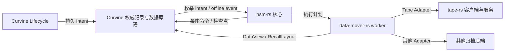

# Curvine HSM 详细设计

版本：v0.2，2026-10-19。本文是目标设计，代码基线、调查范围和验证限制见 [说明](README.md)。协议和故障处理分别见 [Interface](interfaces.md) 与 [实施计划](implementation-plan.md)。当前实施先做通用 hsm-rs 与本地文件系统/data-mover 对接，再接 Curvine，带库后置；不保留旧专有实现兼容路径。

## 1. 设计决定

Curvine 承担源数据的权威记录和受保护原子效果；hsm-rs 是外部 HSM 核心，推进工作流、恢复未知结果、选择归档副本及重试。权威记录的存放位置不决定状态机逻辑的归属。

| 模块 | 拥有的决定与事实 | 明确交给其他模块的工作 |
|---|---|---|
| Curvine Master/Worker | 原生 inode、内容身份、在线布局、pin、权限、持久 HSM 记录；原子数据效果是否合法 | 磁带排队、工作流重试、跨后端选择 |
| 存储内 Lifecycle 模块 | 候选扫描、规则版本、水位、目标存储类、候选预算 | 搬运执行、结果未知时的对账 |
| hsm-rs | 操作协调、控制资格、attempt、检查点、后端结果接纳、释放授权 | 自行改块映射或绕过存储做 CAS |
| data-mover-rs | 在 capability 内搬运、校验、进度及回执；内置 Tape Adapter | 唯一任务真值、Release、正式布局发布 |
| tape-rs/其他后端 | 稳定归档身份、提交事实、内容目录、恢复、介质/设备调度 | 源 inode 权威与通用 HSM 状态机 |



实现时通过四个深模块集中复杂性：`Authority` 隐藏复制提交和结果恢复；`ManagedData` 隐藏视图、布局及引用保护；`Lifecycle` 隐藏原生扫描和候选规划；外部 `HsmCore` 隐藏工作流。其 Interface 必须包含顺序、错误、恢复和资源约束。

## 2. 第一版范围与明确限制

第一版选择完整文件归档与整文件 Recall，支持 Archive 后长期双驻留，并提供独立 Release。先在新建受管 scope 中启用，要求内容已完成且可可靠 seal。

- 采用 closed-file freeze/pin；归档期间拒绝业务内容修改、最后 unlink、free 及可能替换该 inode 的操作。
- 禁用受管范围的短路读写，所有数据读取都通过能验证 lease 的 Worker。可写 FD 无法被远端协议撤销，短路读也会绕过 Release 的引用保护。
- 第一版受管写会话独占，使用唯一 session 和 writer epoch；拒绝旧客户端无 token 的数据访问。
- 默认先支持 file layout；SPDK/bdev 必须通过独立的隔离、耐久、重启和 extent 回收验收后才启用。
- 不实现任意并发写快照、部分驻留、部分 Recall、跨文件去重或直接从磁带服务随机读。
- metadata stat/list/权限查询保持可用；离线数据 open/read 触发共享 Recall。

存量范围启用前必须清退旧短路句柄、旧会话和旧缓存客户端，并验证数据耐久。无证据证明隔离完成时禁止启用，不能用 chmod、超时或 Worker 重启代替清退。

freeze 持续时间包括排队、装带和未知结果对账。业务不能容忍时演进为“短 freeze + 独立持久归档 staging”，最后再按需要实现 manifest/block-generation COW。这两条路线不改变 Release/Recall 的权威合同。

## 3. 源码基础与必要改造

以下事实依据调查基线，具体固定源码链接见文末。

| 当前基础 | 实际限制 | 目标改造 |
|---|---|---|
| Master 元数据集中，RocksDB batch、journal、Raft、checkpoint 已存在 | 普通 FS RPC 修改后入队 journal，不等待多数提交；重复 propose 有易失去重直接 success 分支 | 全局有序 committed command/apply、持久结果、可靠读取 |
| TTL、LRU/LFU、水位和分页查询 | 热度是有限提示；分页非跨页固定快照；回收计数非物理证明 | 原生轻量投影、规则、持久 intent、实际回收结算 |
| 文件 blocks、单块 staging/rewrite | 没有整文件不可变视图；会话写与短路 FD 可继续变更 bytes | generation、会话 fencing、完整 manifest、持久 pin |
| free 保留原生 inode 并清块 | 改变 mtime；Unified cache mode free 可能删 inode；GC 队列是内存 | 独立 Release、读 lease、持久 GC、条件删除 |
| Transfer、块分配与 finalize | 普通 rename 保留临时 inode；block ID 编码 owner inode | 原 inode 下私有 RecallLayout，seal 后条件发布 |

本设计不将 `Cv/Ufs/Both`、正值 `ufs_mtime`、位置列表或传输完成作为持久归档证明。HSM 受管记录与普通 UFS 缓存记录分开解释。

## 4. 权威提交模型

### 4.1 采用 commit-first

```text
认证/leader admission/格式与资源预检
  -> Raft 提交版本化命令（不先改公开元数据）
  -> leader/follower 同一 deterministic apply
  -> apply 内复核条件，短持 fs_dir 锁
  -> 同一 batch 写 inode + HSM记录 + outcome + outbox + applied marker
  -> apply 完成后返回原结果与 committed index
  -> 提交后的 outbox 消费者执行物理副作用
```

预检只优化失败响应；最终条件必须在 apply 复核。命令里的随机 ID、时间裁决与选择结果由提交者给定并校验，apply 不读取不同节点本地时钟、不自行选 Worker、不做网络调用、不等待带库。

推荐在启用 HSM 的 Master 集群切换到统一 metadata command 模式，迁移全部相关 mutation，包括普通创建、写准入/分配/完成、覆盖、截断、链接、重命名、删除、属性/保护修改及 HSM 命令。共享目录和父子关系也进入该顺序。第一版不混用“普通操作提前本地应用”和“HSM 提交后应用”；切换是集群级能力门槛，影响范围应纳入实施成本。

现有 leader 已预应用、follower 才更新 metadata 的重放分流需要重构。新旧格式必须显式分派，不能让新命令在 leader 上仅走 UfsLoader。UFS 副作用移到提交后 outbox，不在 authority apply 内阻塞。提交等待在 fs_dir 锁外进行。

### 4.2 持久性和读一致性

metadata DB 是已提交状态的物化视图，Raft durable log + applied marker + snapshot 构成恢复链。崩溃后先恢复 checkpoint 和已提交日志，达到安全水位后才能对外服务；本地 batch 成功本身不等于 HA 成功。必须验证 DB flush/checkpoint 与日志压缩水位一致，禁止丢弃尚无可恢复快照覆盖的日志。

`InspectMutation`、控制权获取及 Release/Recall 判定查询必须使用 quorum/read-index 或等价线性化读取。读取响应携带应用水位；失去多数派的旧 leader 不得用本地“未找到”授权新破坏动作。普通候选扫描可用声明了陈旧性的读取。

生产模式至少部署三个实际 voter，journal 必须启用；HSM 记录解码或 apply 错误必须停止相关服务并报警，禁止跳过错误推进水位。多数派提交只能证明 metadata 复制，数据副本耐久须另行证明。

### 4.3 幂等和未知结果

一个 workflow 使用 `operation_id`；每个不同权威效果使用独立 `mutation_id`。原请求指纹包含类型、完整语义参数和 expected 条件；同 mutation ID 的参数不得变化。重复执行先读持久 outcome，再检查当前条件。

成功和确定的条件失败都可存为终态 outcome；改变 expected revision 后使用新 mutation ID。通信超时返回 unknown，查询原 mutation，不能根据未收到回包自行补偿删除。详见 [命令合同](interfaces.md#2-命令封装与幂等)。本定义收紧早期“更新 CAS 条件后复用同 ID”的描述。

## 5. 身份与版本

```text
EntityKey = storage_instance_uuid + namespace_incarnation + inode_id
DataKey = EntityKey + data_generation
ArchiveKey = backend_instance_uuid + immutable_archive_id
AllocationKey = EntityKey + allocation_seq + allocation_epoch
LayoutKey = EntityKey + layout_id
```

namespace incarnation 表示新建的身份空间；同一 namespace 的一致备份恢复通常保留它，同时递增 authority recovery epoch 并隔离旧集群。独立克隆必须分配新 namespace 身份，并重新建立/授权归档引用，避免两个集群误删同一副本。

| 字段 | 何时改变 |
|---|---|
| data_generation | 在授予新内容写资格之前；覆盖、截断等内容变化同理 |
| layout_revision | 在线布局切换、Release、同内容 Recall 发布 |
| record_revision | 该受保护实体的控制记录改变 |
| archive_revision | 当前锚点集合或其有效性改变 |
| protection_revision | hold/no_release/保留约束等强保护改变 |
| writer_epoch | 新写会话或撤销旧写资格 |
| controller_epoch | scope 控制者换届 |
| attempt_epoch | 某动作的执行者换届 |

rename、权限修改、归档、Release 和同内容 Recall 不改变 data_generation。新写准入可以保守换代，即使最终没有写 bytes；旧锚点成为旧版本引用，不能恢复授权给新 generation。

`next_seq` 已存在且运行时单调；需要修复/验证 AddBlock replay 未推进分配高水位的缺口。保留现有 40-bit inode + 24-bit seq 编码，所有块分配先持久提交范围，再签发写资格；废弃范围不复用，溢出拒绝分配。逻辑 offset 独立于物理 allocation seq。解除此编码限制另立格式升级，第一版不顺带重构。

## 6. 持久记录与原子范围

建议在原生 metadata DB 增加显式版本化内部 keyspace。下表是逻辑记录，可按访问模式合并 CF，不能变成独立外部 DB。

| 记录 | 主键 | 必要字段 |
|---|---|---|
| ManagedEntity | EntityKey | generation、published_layout、各 revision、管理标志、写 session、freeze、保护摘要 |
| ArchiveAnchor | DataKey/copy_id | ArchiveKey、size、digest、receipt/profile、状态、来源 operation |
| HsmOperation | operation_id | DataKey、动作、外部核心 phase/checkpoint、owner/attempt、view/stage/archive 引用 |
| MutationOutcome | principal/mutation_id | canonical request digest、终态结果、committed index、保留期限 |
| ControlGrant | namespace/shard_id | owner、单调 epoch、续约/撤销状态 |
| DataView/Pin | view_id/pin_id | DataKey、manifest root、owner operation、状态、引用与 fence 证明 |
| Layout/ManifestChunk | LayoutKey/chunk_no | owner、用途、块顺序/长度、allocation、manifest hash、seal 信息 |
| CapacityClaim | claim_id | operation/attempt、scope、逻辑/副本预算、具体分配和结算状态 |
| DurableEvent/Outbox | event_id | DataKey、类型、effect ID、投递/完成状态、outcome 关联 |
| GcIntent | gc_id | 精确 allocations、detach index、引用状态、Worker 确认与重试进度 |
| LifecycleRule/Run/Intent | rule_id/revision/run/intent | 规则、游标、预算、DataKey、目标约束、去重键 |
| EntityTombstone | EntityKey | 删除的 generation、保留引用、清理意图和原幂等身份 |

不得把全部块清单和任务历史嵌入 inode；inode 保存必要标志和链接。inode 编码当前使用 bincode，新增字段需显式版本迁移，不能只凭 serde default 推断向后兼容。内部 key 不开放给普通 xattr 写入/导入/属性复制。

大 manifest 分块持久准备，每块不可变并绑定 owner；最后用 root hash/count/total_length 做短提交 seal。Release/CommitRecall 切换 root 引用，不把百万块列表放进一次 Raft entry。未 seal 的片段不可读，由 owner/cleanup ledger 管理。

实体变更、锚点摘要、operation effect、outcome、outbox、applied marker必须在一次 DB batch 中生效；大集合的准备可以多步，但引用切换必须原子。跨实体 rename/目录操作按原生 namespace 事务一起提交。

## 7. 驻留事实与工作流状态

| 当前版本在线布局 | 当前版本有效锚点 | 驻留事实 |
|---|---|---|
| 有 | 无 | ONLINE_ONLY |
| 有 | 有 | DUAL_RESIDENT；副本不满足目标时标记 DEGRADED |
| 无 | 有 | ARCHIVED_ONLY；Recall 期间保持此状态 |
| 无 | 无 | UNAVAILABLE/LOST，显式报错 |

普通 UFS location 不构成 ArchiveAnchor。锚点必须绑定不可变归档身份、DataKey、完整长度/digest 和已提交回执。介质后来损坏可导致 degraded；历史回执无法保证介质永不失效。

HsmOperation 的业务 phase 由 hsm-rs 定义并通过受限 CAS 保存；存储只强制公共字段和数据效果约束。存储自身维护 View/RecallLayout/GC 的机械状态，不负责重派归档任务或替用户选择后端。

## 8. 稳定 DataView

状态为 `PREPARING -> READY -> CLOSING -> CLOSED`，失败准备先进入可对账清理状态。View pin 生命周期不等于 controller lease、执行器心跳或短期读 capability。

1. 对已 seal 文件提交 PREPARING，绑定 generation、operation、layout，递增 writer fence 并关闭新写准入。
2. 所有可能修改选定 allocation 的 Worker 安装 fence，撤销旧写会话并排空已接纳 write/finalize/abort；确认后返回进程 incarnation 和 fence receipt。
3. 固定 manifest，确认每块精确内容、finalize/耐久副本状态，建立可恢复 pin。
4. 提交 READY 后签发 view capability；执行器只能读取该 manifest 的 allocation，缺块或副本不符明确失败。
5. 外部核心确认无后续源读取需求，撤销 capability、排空读会话，提交 CLOSED 才解除 freeze/pin。

未确认旧写者的 Worker 不能被当成完成；第一版直接停在 PREPARING/失败，不凭“从 location 列表移除”证明其无法再修改共享 allocation。Worker 重启先恢复/从 authority 重新核实 fence 和 pin，之后才服务受管 I/O/GC。

view 读取不依赖当前路径，不 fallback 到 latest/UFS。rename 不影响视图；其他硬链接、递归删除、TTL 和管理员操作按 inode 检查 freeze。后端提交未知时可以由核心选择先关闭已停止读取的 view，再继续查询后端；无证据证明读取已停止时不得解冻。

## 9. Release

Release 的效果是撤销在线布局，保持 inode、内容 generation、逻辑长度、内容 mtime、路径关系和归档引用；其成功不等于磁盘已腾出全部空间。

第一版采用 BUSY 语义：有任何在线 reader lease、source view、writer、Recall stage 或强保护时不执行。新读准入/续约和 Release 使用同一 authority 顺序：Release apply 前的有效 reader 会阻止它，Release apply 后的新 open 得到 Offline。无需为了等待带库或长读持全局锁。

外部核心检查副本/故障域/保留策略，形成绑定 DataKey、layout/archive/protection revision、允许锚点集合、operation 和 controller epoch 的授权。存储验证授权身份、当前条件和仍有效锚点，原子把 published layout 转成 detached layout，并创建持久 GC intent/outcome。

旧布局仅在无引用、已提交 detach 且 Worker 隔离成立时进入回收。Worker 对精确 AllocationKey 执行幂等删除；结果单独结算。core 不调用 data-mover 的 move/delete 代替 Release。详细交错见 [Release 协议](interfaces.md#5-release-协议)。

## 10. Recall 与 CommitRecall

Recall 是外部核心协调的完整流程；存储数据原语为 `PrepareRecall / SealRecall / CommitRecall / AbortRecall`。

1. 由显式请求、预取意图或离线访问事件合并出该 DataKey 的单个活动 Recall。
2. 核心选择有效 ArchiveKey，申请持久 CapacityClaim。
3. 在原 inode 下提交私有 RecallLayout，分配不复用的 allocation 范围，签发本 attempt 写 capability。
4. 执行器读取精确归档并写私有布局；普通读仍见 Offline。
5. Worker 关闭写会话并提供持久 finalize/副本回执，执行器完成端到端校验，存储确认后 seal。
6. CommitRecall 在一次提交中验证 DataKey、owner/attempt、layout revision、sealed receipt、claim 和最新保护条件，切换 published root 并保存 outcome。
7. 提交后通知等待者重新 Open；保持原 inode、硬链接、当前路径/权限/标签和内容时间。

普通临时文件 rename 或交换 blocks 不满足 owner 编码。block report、复制修复、丢 Worker 处理和 GC 必须识别 `PUBLISHED / RECALL_PRIVATE / VIEW_PINNED / DETACHED` 四类 owner。私有块的 owner 记录必须在允许写入前提交。

CompleteFile/正常用户写不能替代 CommitRecall。若用户全量替换已增 generation，旧 Recall 只能清理自己的 stage；部分写、append 和保留旧字节的 truncate 默认先 Recall。容量耗尽、摘要不符或后端 unknown 均不发布半成品。

## 11. 在线访问与读 lease

`OpenManagedRead` 返回 `Online(ReadLease, manifest)` 或 `Offline(DataKey, event_id)`；后者原子 EnsureAccessEvent 去重。SDK/FUSE 在锁外异步等待/轮询，支持取消和超时。metadata stat/list 不触发 Recall。

同 DataKey 多个等待者共享事件/Recall，单个等待者退出不取消其他人的任务；等待句柄仅是通知优化，持久事件可枚举恢复。事件完成前必须检查同 generation 已在线，客户端重新取布局，不能直接复用旧缓存位置。

读 lease 绑定 DataKey/layout/客户端 incarnation，开块、流内读和续约均受检查。第一版由单个 managed session 绑定一组读句柄，Master 可靠登记；Worker 在故障重启时先暂停，再与 authority 对账。普通 worker 重试不自动获得新的读取资格。

lease 到期只会关闭新读资格；GC 还要确认已接纳 I/O 停止。由 authority 生成精确回收资格，Worker 排空会话后 ack。若采用有界时钟偏差的到期隔离优化，须另行定义及验收偏差上界；第一版不靠时钟猜测回收。

FUSE 将 Busy、离线等待超时、后端不可用等映射为明确可重试错误；具体 errno 按现有 SDK 约定实现并测试。离线零块不得被当作空洞或零长度内容返回。

## 12. 生命周期策略

`LifecycleManager` 在 Master 后台运行，内部包括 CandidateScanner、RuleEvaluator、CapacityPlanner、IntentPublisher。它不占用前台请求长锁，不做小时级网络动作。

规则包含 scope/标签、文件完成状态、mtime 冷却、大小范围、保护标记、目标 storage class、副本数/故障域及 Archive/Release 条件。规则定义显式版本；运行记录绑定 rule revision。复杂副本健康和后端资源判断由核心最终处理。

扫描直接读取 inode/HSM 投影，使用稳定 ID 游标、页数/字节/时间预算和有界 top-K。跨页不承诺固定快照；记录 scan epoch、周期重扫、允许重复和过期候选。scope 按当前路径评估，intent 登记时复核；强保护在最终数据效果再次复核。

意图按 `(DataKey, action, target_requirement_digest)` 去重，run_id 不参与内容去重。持久 pending 表为投递真值，通知是提示。规则改变后未执行意图可取消/替代，活动工作流由核心对账，不能自动撤销已提交事实。

HSM 范围内原 TTL/eviction 统一提交意图；`set_attr(ufs_mtime)` 不能改变 HSM 锚点或授权释放。LRU/LFU 只作为近似排序提示，第一版以完成状态、mtime、大小和标签为主要规则。扫描周期与前台 p99 必须在目标规模实测。

拟议规则示例（目标 schema，当前配置解析器不支持）：

```yaml
id: research-cold-data
revision: 1
scope: /datasets/research
select:
  complete: true
  modified_before: 30d
  min_size: 64MiB
  exclude_labels: [no_archive]
archive_goal:
  storage_class: tape-standard
  required_copies: 1
release:
  enabled: true
  require_archive_goal: true
  exclude_labels: [no_release, hold]
  trigger: online_high_watermark
execution:
  max_frozen_bytes: 1TiB
  max_pending_intents: 10000
```

数值仅用于展示 schema，不是生产推荐。scope 匹配、标签与保留语义均由明确版本的 evaluator 实现；不能让自由字符串表达式在 apply 内执行不确定代码。

## 13. 容量与实际回收

账本区分：逻辑长度、在线物理占用、source pin、Recall 预留、已分配未发布、detached 待回收、实际回收、各类副本开销。禁止用候选逻辑长度直接增加可分配空间。

CapacityClaim 采用两级记录：scope 总预算及具体 Worker allocation。先提交 claim，再分配范围，Worker 为 allocation 提供可恢复的物理占用/预留；不能超配同一额度。发布把 stage 占用转为 published 占用，Abort 只有物理清理确认后才退还已经实际使用的部分。

未分配预算可以在明确取消后释放；有写入可能的 allocation 必须先 fence/drain 再 GC。claim 不因 core 或 worker 心跳短暂丢失自动退款。后台对比 physical report 和账本，差异进入待对账，不能双重计算空闲。

高水位可产生 Release 需求，低水位设目标；预归档储备、在途可回收、实际回收分别计量。Recall 保留独立最低预算和资源优先级，防止空间压力导致永久无法召回。上限是部署配置，首版不提供未经测量的默认容量比例。

## 14. GC、删除与归档副本生命周期

GC 只消费已提交精确 intent，副作用至少一次执行；effect ID、AllocationKey 和 Worker incarnation 支持幂等。Master 重启重建队列，Worker 确认物理删除后再更新完成记录。若一批很大，进度分片提交，父 intent 仅在全部确认后终结。

所有删除决策先查询统一 owner/reference 索引。block report 中未识别的受管块进入隔离/对账，禁止按“不是 file.blocks 当前成员”立即删除私有或 pinned 块。未知 owner、未知查询结果、后端 unknown 都不构成删除授权。

普通最后 unlink：有 view 时第一版 Busy；无 view 时将实体转 tombstone、取消新读写并生成在线/归档清理意图。已有 reader 的布局保留到会话排空。业务删除不要求等待装带，但 tombstone、幂等结果和归档引用保留到安全清理完成。

删除归档副本由核心协调：先确保当前在线或其他已验证副本满足保护，再以 CAS 标记 retiring；确认无 active view/Recall/保留约束后提交 retirement grant，后端按稳定 ID 逻辑删除。物理带上空间由后端 repack 回收。新旧核心不得在 pending retirement 中把同一副本重新计为有效；响应丢失查询原结果。

源 tombstone 和后端 catalog 是不同事实，不要求分布式事务；两者间的 intent/outcome 必须能对账。永久物理损失等异常进入明确不可用状态，不能用回收流程掩盖数据丢失。

## 15. 外部核心和执行器接入

Curvine Adapter 实现 HSM 核心需要的控制/记录、事件、DataView、Release/Recall Interface。hsm-rs 直接改为通用 EntityKey/DataKey 与 ManagedStorage / ArchiveBackend / DataMover，不保留旧 Lustre/copytool/v1 插件兼容实现。首个实际 Adapter 是本地专用 managed namespace 和本地 archive，验证 data-mover 有界搬运及归档/释放/恢复。Curvine 生产核心启动后需先取得 ControlGrant，枚举非终态 operation、pending intent/event，再向后端查询未知提交结果。

data-mover-rs 仍是库。当前本地实现由通用 hsm-engine 组合 hsm-local 执行器直接调用；未来再按扩展需求分离 worker 宿主。Curvine 需要新增 view source 和 Recall layout destination，支持 capability 续签，禁止普通路径 fallback；源/目标取消后报告 uncertain 或 stopped，不假装全局事务回滚。

Tape Adapter 内置 data-mover-rs 并依赖 tape-rs 客户端，提供 Archive / InspectArchive / ReadArchive / RetireArchive。归档 ID 在第一次提交前固定，换 attempt 不换 archive identity；并发重复写必须由后端幂等/冲突检测处理。具体库版本要先对齐现有插件接口代差。

tape-rs 的 STAGED/202 只能记录中间检查点。只有精确 COMMITTED 回执、算法标记的 digest、完整长度及满足目标的 durability profile 才可登记锚点。建议 MVP 使用 SHA-256 作跨模块端到端摘要，同时保留算法字段；现有 BLAKE3 等值不能直接作为 SHA-256 比较，必要时重新计算或分别验证。

所有后端返回 `Absent / Pending / Committed / Failed / Unknown`，Unknown 不等于 Absent。源只保存稳定 ArchiveKey/receipt/profile，不保存条码和物理 extent；repack 不改变源归档身份。归档 catalog 与物理设备 fencing 仍由后端可靠维护。

## 16. 安全、配置、升级和观测

权限分为 Lifecycle 候选读/提交 intent、HSM 控制/受保护命令、worker 数据 capability、后端介质权限。普通客户端无权写 HSM key、伪造回执、发布 Recall 或 Release；worker 无管理控制权。capability 是短期最小权限凭据，数据 pin 是持久保留事实。

新增配置采用 `hsm.enabled`、受管 scope、允许 layout/backend profile、session/扫描/预算上限与客户端能力版本。启用前检查 journal、多 voter、提交模式、schema、Worker 协议、短路关闭、数据耐久验收及旧会话清退。仅启用扫描 dry-run 不授予 Release 权限。

升级采用“支持新格式的 reader/apply 全部部署 -> 验证 quorum/Worker 能力 -> 显式激活 -> 新命令写入”。持久 envelope 带 schema version；无法理解关键状态的节点不得投票/服务该范围。激活后禁止降级到忽略 HSM 的旧版本，回退只能停止新任务并 drain，不能删除记录退回缓存语义。

备份覆盖 inode、HSM keyspaces、allocator、outcome、outbox、applied marker。灾难恢复时先隔离旧集群、提高 recovery epoch、恢复权威日志并对账后端；自动 Release/Retire 在对账完成前暂停。介质内容可恢复不等于 namespace/ACL/硬链接可完整重建。

指标关联 EntityKey/DataKey/operation/mutation/attempt/ArchiveKey：pending/unknown 年龄、freeze 数量/字节/时长、Recall 等待、claim 与实际占用、GC 延迟、摘要错误、stale token、扫描完整周期及前台延迟。审计记录 policy revision、拒绝原因和 committed index；高频进度不是正确性日志。

## 17. 固定源码依据

以下链接固定于原调查提交；基线差异见 [README](README.md)。

- [FS free 与元数据操作](https://github.com/CurvineIO/curvine/blob/964b98f6a36e12230b97e07ef871b918eb5a73d5/curvine-master/src/master/fs/master_filesystem.rs#L262)、[journal writer](https://github.com/CurvineIO/curvine/blob/964b98f6a36e12230b97e07ef871b918eb5a73d5/curvine-master/src/master/journal/journal_writer.rs#L77)、[异步 SenderTask](https://github.com/CurvineIO/curvine/blob/964b98f6a36e12230b97e07ef871b918eb5a73d5/curvine-master/src/master/journal/sender_task.rs#L110)。
- [重复 propose 分支](https://github.com/CurvineIO/curvine/blob/964b98f6a36e12230b97e07ef871b918eb5a73d5/crates/metadata/curvine-raft/src/raft/raft_server.rs#L131)、[下层持久与 apply ACK](https://github.com/CurvineIO/curvine/blob/964b98f6a36e12230b97e07ef871b918eb5a73d5/crates/metadata/curvine-raft/src/raft/raft_node.rs#L655)、[leader/follower replay](https://github.com/CurvineIO/curvine/blob/964b98f6a36e12230b97e07ef871b918eb5a73d5/curvine-master/src/master/journal/journal_loader.rs#L237)。
- [读者按需开块](https://github.com/CurvineIO/curvine/blob/964b98f6a36e12230b97e07ef871b918eb5a73d5/crates/client/curvine-client-core/src/file/fs_reader_base.rs#L149)、[短路 writer](https://github.com/CurvineIO/curvine/blob/964b98f6a36e12230b97e07ef871b918eb5a73d5/crates/client/curvine-client-core/src/block/block_writer_local.rs#L48)、[Worker 写会话](https://github.com/CurvineIO/curvine/blob/964b98f6a36e12230b97e07ef871b918eb5a73d5/curvine-worker/src/worker/handler/write_handler.rs#L111)。
- [block ID 编码](https://github.com/CurvineIO/curvine/blob/964b98f6a36e12230b97e07ef871b918eb5a73d5/curvine-master/src/master/meta/inode_id.rs#L21)、[AddBlock 日志](https://github.com/CurvineIO/curvine/blob/964b98f6a36e12230b97e07ef871b918eb5a73d5/curvine-master/src/master/journal/journal_writer.rs#L190)、[AddBlock replay](https://github.com/CurvineIO/curvine/blob/964b98f6a36e12230b97e07ef871b918eb5a73d5/curvine-master/src/master/journal/journal_loader.rs#L749)、[rename](https://github.com/CurvineIO/curvine/blob/964b98f6a36e12230b97e07ef871b918eb5a73d5/curvine-master/src/master/meta/fs_dir.rs#L447)。
- [TTL 动作](https://github.com/CurvineIO/curvine/blob/964b98f6a36e12230b97e07ef871b918eb5a73d5/curvine-master/src/master/meta/inode/ttl/ttl_executor.rs#L70)、[quota](https://github.com/CurvineIO/curvine/blob/964b98f6a36e12230b97e07ef871b918eb5a73d5/curvine-master/src/master/quota/quota_manager.rs#L137)、[多块查询基线差异](https://github.com/CurvineIO/curvine/commit/feb3c9e20617d5c3f36c67d44033239b6ac92470)。

这些依据证明当前结构和改造入口；commit-first、DataView、Release/Recall Interface 及故障收敛仍须实现与验收。
