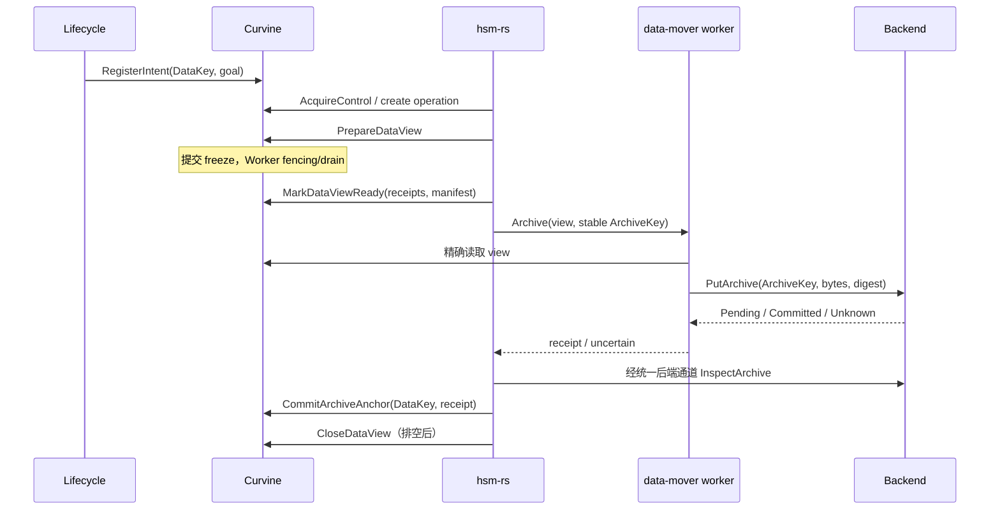

# HSM Interface 与操作协议

本文件给出目标协议，未定义现成 RPC。职责与数据模型见 [详细设计](design.md)，实施落点见 [计划](implementation-plan.md)。公共名称统一使用 `Release` 和 `Recall`；早期 DetachOnline 对应 Release，PublishOnline 对应 CommitRecall。

## 1. Interface 分组

外部核心通过一个 Curvine Adapter 使用控制/记录和数据效果；执行器通过窄数据通道读 view 或写 private layout。管理命令由类型化 command 承载，避免暴露任意键值/块向量写入。

```text
Authority:
  AcquireControl / RenewControl / RevokeControl
  SubmitManagedCommand / InspectMutation / ReadManagedEntity
  ListPendingOperations / ListPendingEvents

Lifecycle:
  PutRule / ScanCandidates / RegisterIntent / ListPendingIntents

ManagedData commands:
  PrepareDataView / MarkDataViewReady / CloseDataView
  CommitArchiveAnchor / Release
  PrepareRecall / AllocateRecallRange / SealRecall / CommitRecall / AbortRecall
  RegisterRead / RenewRead / CloseRead / EnsureAccessEvent

Data channel:
  ReadViewBlock(view_capability, allocation, range)
  WriteRecallBlock(stage_capability, allocation, stream)
  FinalizeRecallBlock(stage_capability, allocation)
```

Prepare/Ready/Seal/Commit 是持久事实变化，均通过 Authority 提交。Get/View manifest、短期 capability 续签及通知可作为读取或授权投影，但不得产生未提交的数据效果。worker 无权提交 Release 或 CommitRecall。

## 2. 命令封装与幂等

```rust
// 伪 Rust，仅表达合同。
struct CommandEnvelope {
    protocol_version: u32,
    namespace_incarnation: Uuid,
    authority_recovery_epoch: u64,
    principal: PrincipalId,
    mutation_id: Uuid,
    operation_id: Option<Uuid>,
    control: Option<ControlToken>,
    expected: Preconditions,
    command: ManagedCommand,
}

struct Preconditions {
    entity: Option<EntityKey>,
    data_generation: Option<u64>,
    record_revision: Option<u64>,
    layout_revision: Option<u64>,
    archive_revision: Option<u64>,
    protection_revision: Option<u64>,
    attempt_epoch: Option<u64>,
}

struct MutationOutcome {
    mutation_id: Uuid,
    canonical_request_digest: Digest,
    committed_index: u64,
    result: AppliedResult, // 成功或确定失败，含该次原返回值
}
```

canonical digest 覆盖规范化后的业务参数、expected 条件、principal/namespace、command 类型；不包含重连地址、trace ID 或 transport req_id。token 的签名刷新不改变业务身份，control epoch/attempt 等授权绑定不能变化。transport req_id 与 mutation_id 分开。

apply 顺序必须是：

1. 校验 envelope/schema/调用身份。
2. 查持久 outcome：同 ID 同 digest 返回原结果；同 ID 不同 digest 返回 IDEMPOTENCY_CONFLICT。
3. outcome 不存在时检查 recovery/controller/attempt、DataKey 和 expected revision。
4. 检查 effect 专属约束，原子写数据效果、最小 operation effect、outcome 和 outbox。
5. 返回明确的 applied index 和原结果；禁止返回无凭据的默认 success。

确定的条件失败提交 outcome，不改变目标数据。刷新 expected revision 是新命令，使用新 mutation_id；原 operation_id 保持不变。成功命令在后来 generation 改变后重试仍返回原成功，不重新执行。

授权已失效但 outcome 原本成功时，具备结果读取权限的调用者仍可查询原结果；不能据原成功继续获得新 capability。结果读取权限与新 effect 授权分开。

`InspectMutation` 使用线性化读取，返回 `Terminal(outcome) / NotObservedAt(index) / ResultExpired / Unavailable`。NotObservedAt 仅表示截至该水位未见结果，原请求可能仍在途；应重发完全相同命令或提交有序撤销/换 attempt，不能据此做相反破坏动作。

outcome 清理保留最小 tombstone/接受窗口。已过接受窗口的 ID 返回 ResultExpired，不当作新请求执行；接受窗口和压缩水位需持久化，覆盖最长允许重试与后端迟到时间。

## 3. 错误与调用者动作

| 返回 | 语义 | 调用者动作 |
|---|---|---|
| APPLIED | 已多数提交并完成 apply，有原结果/index | 推进下一步 |
| PRECONDITION_FAILED | 该命令确定未产生目标效果，失败已记录 | 查询当前事实，重新计划并用新 mutation |
| BUSY | 当前存在 reader/writer/view 等冲突 | 等待/退避；新判断使用新 mutation |
| STALE_CONTROL / STALE_ATTEMPT | 当前执行资格失效 | 停止新效果，由当前所有者接管 |
| DATA_CHANGED / DELETED | 源内容换代或实体已删 | 禁止将旧副本授权给新数据；只清理自己资源 |
| INTEGRITY / DURABILITY_UNSATISFIED | 长度/digest/副本回执不满足 | 不 seal/发布；修复或切换后端 |
| NO_CAPACITY | 没有足够可兑现预算 | 等待/调整；不可发布部分布局 |
| UNKNOWN / transport timeout | 是否已执行未知 | Inspect/同 mutation 重试 |
| NOT_LEADER / QUORUM_UNAVAILABLE | 当前节点不能提供权威效果/查询 | 换 leader 或等待，不信本地负结果 |
| CAPABILITY_EXPIRED / FENCED | 不能继续数据会话 | 停止 I/O；当前 owner 查询后续签或重建 |
| RESULT_EXPIRED / UNSUPPORTED_SCHEMA | 无法安全解释原命令/状态 | 对账或升级，禁止静默重做 |

错误带 mutation/operation、可重试类别、观测水位及具体冲突，不包含未授权的内部凭据。

## 4. Archive 协议

外部 operation 参考 phase：`INTENT -> PREPARING_SOURCE -> TRANSFERRING -> WAITING_COMMIT -> ANCHORED -> DONE`；另有 `RECONCILING / CANCELLING / FAILED`。具体 phase 逻辑在 hsm-rs，存储持久保存 checkpoint 并限制关联资源。



实际后端调用经 worker/data-mover 的统一 Interface，图中 Inspect 的逻辑调用不表示核心依赖磁带内部实现。

关键合同：

- 创建 operation 时固定 ArchiveKey，重复 attempt 查询/写同一不可变归档身份；后端同 ID 不同内容必须冲突。
- view READY 前不派发源读取；只接受选定 manifest，重新打开路径不合法。
- STAGED/202/Pending 可保存检查点，不能 CommitArchiveAnchor 为有效副本。
- Committed 回执绑定 backend instance、ArchiveKey、DataKey 或内容身份、length、算法标记 digest、durability profile。
- 核心验证回执后通过受保护命令登记锚点；存储复核关联关系和 generation。旧 generation 的结果只能登记为明确旧版本或待清理，不能进入当前 release 集合。
- 核心/worker 崩溃后先查 operation/view 和后端精确结果，再决定续传、重做或关闭 view。无法判断时维持保护。
- 已确认无源读取会话时可以关闭 view 后继续对账未知后端提交，避免无必要长期冻结；锚点未确认前仍禁止 Release。
- Abort 先撤销 attempt/数据会话并排空，再释放 pin；归档 orphan 清理另有 intent。

## 5. Release 协议

```text
Release {
  DataKey,
  expected_layout_revision,
  expected_archive_revision,
  expected_protection_revision,
  approved_anchor_set,
  operation_id,
  controller_epoch
}
  -> {residency: ARCHIVED_ONLY, layout_revision, gc_id, committed_index}
```

前置条件：当前 published layout 属于该 DataKey；已有有效 committed 锚点；授权集合与修订匹配；无 writer、source view、reader lease、私有 Recall 或 hold/no_release。零长度内容可以无物理 GC，不能因此跳过身份/保护条件。

第一版 reader 登记/续约和 Release 进入同一命令顺序，apply 在锁内复核。没有 reader 时一次提交：

```text
published_layout := None
residency := ARCHIVED_ONLY
layout_revision += 1
old_layout.owner := DETACHED(gc_id)
persist(gc_intent, operation_effect, mutation_outcome)
```

内容 generation、长度、内容 mtime、inode 身份和归档锚点保持。提交后才签发 GC grant/执行删除，不能在预检或 Raft 入队时删块。

| 并发/故障 | 必须结果 |
|---|---|
| Open 先提交 | reader lease 存在，Release 返回 Busy |
| Release 先提交 | Open 得到 Offline/event，触发 Recall |
| Release 成功但回包丢失 | 同 mutation 返回原 gc_id，不创建第二个效果 |
| detach 提交后 Master 崩溃 | 从 GcIntent 重建回收队列 |
| 旧删除命令在下一次 Recall 后到达 | AllocationKey 不同，不触及新布局 |
| Worker 无法确认安全停止旧 I/O | 不回收其 allocation，保持待处理 |
| GC 一部分完成 | 在线仍是 ArchivedOnly；回收进度部分完成，空间按实际结算 |

`Release` 成功返回“逻辑在线布局已撤销”；`InspectGc(gc_id)` 提供物理回收进度。界面/API 不把前者称作磁盘全部已空闲。

## 6. Recall 协议

### 6.1 共享访问事件和唯一活动操作

`EnsureAccessEvent(DataKey)` 以 DataKey 去重，在同一提交中关联已有活动 recall_id 或建立 pending event。hsm-rs 的创建命令以唯一索引约束同 DataKey 一个活动 Recall；多个 policy/读者并发都关联同一结果。

客户端等待自身 event，使用截止时间和取消；不会持有 Master namespace 锁。event/operation 分开：无人等待时预取仍可继续，核心依据策略决定是否取消。跨 generation 的事件不合并。

### 6.2 PrepareRecall

```text
PrepareRecall(DataKey, recall_id, attempt, source_anchor, size,
              expected_layout_revision, capacity_requirement)
  -> {recall_layout_id, claim_id, stage_capability_descriptor}

AllocateRecallRange(recall_layout_id, attempt, ordinal_range, worker_plan)
  -> {committed_allocation_range, allocation_keys, write_capabilities}
```

Prepare 验证实体仍存在且离线、source anchor 不处于 retirement、大小及 DataKey 关联；创建原 inode 私有 layout 和持久 claim。每个块范围的 allocator 高水位、owner 及额度先提交，再允许写入。ordinal/offset 不依赖分配序号连续。

大文件分片分配，避免一次命令载入全 manifest；claim 先覆盖预期完整恢复，分片不得超领。分配中途失败不回退 next_seq，已消耗序号永久保留。

### 6.3 写入与 SealRecall

stage capability 只允许本 layout/attempt 的特定 allocations。Worker 为私有块保存可恢复 owner，拒绝旧 token 的写、批量写、finalize、abort 和 replication 变更。block report 必须按私有 owner 接纳，不能按普通 file.blocks 缺失删除。

每个 block finalize receipt 至少包含 allocation/owner、length、digest algorithm/value、Worker/disk incarnation、持久化 profile、replica identity、fence epoch。file layout 要证明数据和发布后的可恢复元数据已同步；bdev 要证明数据与 allocator/extent 元数据持久一致。仅看到 location 或 flush 到进程缓冲区不够。

`SealRecall(layout, expected_manifest_root, whole_length, whole_digest, receipts)` 执行：

1. 关闭该 layout 新写准入，撤销/排空当前数据写会话。
2. 验证 manifest 无缺失/重叠，ordinal/长度覆盖完整文件。
3. 验证每个 allocation 已 finalize，达到 scope 的在线副本/耐久 profile。
4. 比对选定 ArchiveAnchor 的整文件算法/摘要/长度。由已授权验证者读取精确 sealed bytes 计算 whole-file digest，绑定 manifest root、attempt 和 profile；Master 验证可信回执，不尝试把分块 SHA-256 直接拼成整文件 SHA-256。
5. 提交 SEALED 和不可变 seal receipt；随后数据变化必须使用新 attempt/layout。

验证者是现有执行器的受信校验角色或独立验证 worker，信任域需部署明确；第一版防故障与并发错误，不宣称抗被攻陷的校验者。副本丢失或 Worker 重启后需重验相关 receipt，不能把过期 incarnation 的在线性保证当作当前可用证明。

### 6.4 CommitRecall

```text
CommitRecall {
  DataKey, recall_id, attempt, layout_id,
  expected_layout_revision, immutable_seal_receipt,
  controller_epoch, claim_id
}
  -> {published_layout_id, layout_revision, committed_index}
```

apply 再次检查原 inode/DataKey、操作/attempt、私有 owner、seal 的精确 manifest、发布条件及 claim。与已提交的副本丢失/保护更新排序，已经不满足耐久/保护条件则拒绝发布。瞬时硬件故障不能由 metadata 原子性消除，但不得明知缺副本仍冒充满足配置。

同一 batch 将布局转 PUBLISHED，原 inode 指向该 root、递增 layout revision、把已使用 claim 转正式占用、写 operation effect/outcome，并登记 access event 可完成的效果。提交后通知客户端重新 Open；hsm-rs 可随后把业务 phase CAS 为 DONE。存储不会自行决定再次 Recall。

### 6.5 Abort、接管与已换代

Abort 仅作用于自身未发布 layout：先提交撤销 attempt/新写资格，向所有写者 fencing/drain，提交清理 GC，确认物理删除后结算 claim。提交与数据隔离未完成不能提前退还实际占用。

新核心接管先读持久 outcome；同 mutation 的 CommitRecall 已成功则接受原结果，不执行 Abort。已发布 layout 的 Abort 必须拒绝，不能删除正式数据。

worker 换届保守采用新 attempt + 新 layout/allocations，旧 stage 按撤销协议清理。controller 换届可接管既有操作记录，但要撤销旧数据资格、核实 seal/布局后再授权；不能盲目继续旧会话。续用 immutable sealed stage 是可选优化，必须重新验证 owner/receipts。

同路径新文件、全量覆盖或最后 unlink 已改变身份/代际时，旧 Recall 返回 DATA_CHANGED/DELETED；旧 stage 清理只针对自身 AllocationKey，不写当前文件。rename 不改变 EntityKey，按原 inode 发布即可。

## 7. Worker fencing 与 capability

```text
Capability = authenticated {
  protocol_version, namespace_incarnation, recovery_epoch,
  worker_id, worker_process_incarnation,
  EntityKey, DataKey, layout_or_view_id, allocation_keys,
  allowed_actions, session_id, writer_or_read_epoch,
  controller_epoch, operation_id, attempt_epoch,
  grant_id, validity
}
```

控制 authority 签发/验证 token；签名或认证通道的具体实现沿用部署安全体系，但字段、权限和时序不可省略。Worker 进程 incarnation 每次启动改变，旧进程 token 不在新进程自动复活。

Worker 状态：`RECOVERING -> FENCE_INSTALLED -> SERVING`。启动先验证 authority recovery epoch、已提交 owner/pin/fence 和本地 allocation 台账；对无法核实的受管 allocation 禁止写和 GC。受管数据不能走不识别此协议的旧 Worker/replication target。

`InstallFence` 必须来自已提交 effect。Worker 记录更高 fence，禁止旧 admission，终止旧流，等待所有已接纳操作/finalizer 停止后返回 durable fence ack。不能仅在新 open 检查 token，随后 stream/batch write 仍无条件接受；每次 I/O 或等价的可撤销 session 锁都要受 fence 约束。

第一版普通写独占：旧 writer 未明确关闭/隔离时不授予新 session。授予新写资格前提交新 generation；complete/seal 绑定 session、manifest、长度和耐久回执。失联 writer 不能仅靠心跳超时被视为已经停止修改 bytes。

旧 leader 在失去 quorum 后不能生成新的可验证 grant。已经提交的精确 GC intent 可由新 leader 重投，但物理执行须核实无引用/已隔离；它的正确性不依赖“收到消息的人自称 active”。恢复期间提高 recovery epoch，所有旧 session 失效并排空。

View READY 需要可能影响所选 bytes 的旧写者均已隔离。对失联且可能仍持有效 FD/会话的节点，第一版中止准备；不把移除节点名字当作物理 fencing。受管短路读写保持关闭。

## 8. 持久 GC 与容量结算

GC grant 绑定 gc_id、committed detach index、AllocationKey、owner/layout、recovery epoch 和命令权限。Worker 检查本地 owner 相符、无 active I/O/reference、删除资格有效后执行。重复返回原结果；identity 不符拒绝并报警。

GC 子状态：`PENDING -> FENCING -> DELETING -> CONFIRMED`；失败可重试，不假定未执行。worker 崩溃后通过本地物理事实及 owner 台账恢复，Master 只在精确确认后结算已使用空间。

CapacityClaim 的纯预算余额与已落盘 allocations 分开。CommitRecall 不把正式在线占用退回 free；Abort 不把尚未回收块当空闲。所有 debit/convert/refund 使用独立幂等 mutation，后台物理报表对账防止重复结算。

## 9. 最小可观察结果

```text
InspectOperation(operation_id):
  DataKey, external_phase, last_effects[], controller/attempt,
  source_view, stage, ArchiveKey, pending_unknown, last_error

InspectEntity(EntityKey):
  generation, residency, revisions, anchor_summary,
  reader/writer/view protections, active_recall

InspectGc(gc_id):
  detached_layout, total/confirmed/pending allocations,
  observed_reclaimed_bytes, retry_reason
```

观测结果声明一致性和观测时间；进度字节和 estimate 不具备发布/释放授权。读取 token、后端凭据和完整性回执按权限裁剪。

## 10. 控制资格与工作流检查点

第一版以 `(namespace_incarnation, fixed_shard_id)` 分配控制资格；shard 由 EntityKey 稳定哈希得到，数量写入版本化配置。路径 scope 用于策略，不能用可重叠/可改名的路径直接定义独立控制者。扩缩 shard 要先 drain 或提供显式 epoch 迁移协议。

`AcquireControl` 是已提交条件命令：核对旧 grant 已撤销/按权威规则可接管，原子递增 epoch 并绑定 owner。续约同样提交，时间裁决作为确定性命令输入；follower 不自行用本地时钟决定控制权。定时器只触发接管提议，真正资格以 committed epoch 为准。

所有 effect 在 apply 时核对当前 controller epoch；新的控制者接管既有 operation 不必改 operation_id，但须撤销旧 attempt 的数据资格，并通过 Worker fencing/drain 确认，之后才重新授权。时钟超时不证明旧执行器 I/O 已停止。

`UpdateOperationCheckpoint(operation_id, expected_revision, phase_schema, payload)` 仅更新当前 owner 的外部工作流字段，限制大小、schema 和关联资源身份。它不能修改 generation、锚点有效性、pin、published layout、claim 或 outcome；这些只能通过对应类型化 command 产生。存储返回的 operation_effect 与业务 phase 分开，允许在数据效果已经提交但核心尚未更新 phase 时接管恢复。

核心启动恢复顺序：线性化读取 control -> 取得新 grant -> 枚举非终态 operation 和 pending intent/event -> 查询未知 mutation -> 查询后端 ArchiveKey -> 隔离旧数据 attempt -> 按持久事实更新检查点或重新派发。没有一个步骤需要重建外部全量 namespace 镜像。
